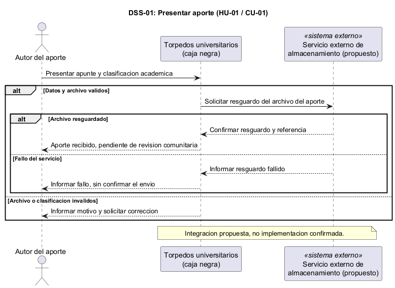

# Diagramas de secuencia de sistema

En ambos diagramas, **Torpedos universitarios** aparece como una única caja negra. Las actividades internas de frontend, backend y base de datos no forman parte de estos diagramas. Los servicios de archivos y correo son integraciones propuestas para la especificación.

## DSS-01: Presentar un aporte

- Caso de uso: [CU-01](./09-casos-de-uso.md)
- Historia: [HU-01](./04-historias-usuario.md#hu-01)
- Requisitos: [RP-01, RP-02, RP-20](./03-requisitos.md)
- Integración: servicio externo de almacenamiento de archivos (propuesto).

Fuente editable: [`dss-01.puml`](./diagramas/dss-01.puml)

**Escenario principal:** el autor presenta un apunte válido. El almacenamiento confirma el resguardo y la versión queda en la cola de revisión comunitaria.

**Opciones de clasificación:** el selector de ramo ofrece solo los ramos de la carrera seleccionada y el de tema solo los temas del ramo seleccionado; el período académico se elige con independencia del ramo. La validación del servidor rechaza combinaciones incoherentes.

**Confirmación al autor:** la respuesta exitosa muestra los identificadores del aporte y de la versión, la clasificación, el estado y la aclaración de que aún no se publica; no expone hash SHA-256, referencia de almacenamiento, tipo MIME ni fecha de creación de la versión.

**Variantes `alt`:** datos o archivo inválidos y fallo de almacenamiento. El sistema informa el motivo y no remite la versión a revisión.

## DSS-02: Registrar la decisión y comunicar el feedback

- Caso de uso principal: [CU-05](./09-casos-de-uso.md)
- Casos relacionados: [CU-03 y CU-13](./09-casos-de-uso.md)
- Historia principal: [HU-05](./04-historias-usuario.md#hu-05)
- Historia relacionada: [HU-03](./04-historias-usuario.md#hu-03)
- Requisitos: [RP-04, RP-06, RP-07](./03-requisitos.md)
- Integración: servicio externo de correo (propuesto).
- Actor externo: Experto en la materia (convocado por la comunidad).

Fuente editable: [`dss-02.puml`](./diagramas/dss-02.puml)

**Escenario principal:** cualquier Moderador abre una versión pendiente, revisa el archivo y registra la decisión. Se guarda su identidad y solo se confirma la primera decisión válida. Una aprobación habilita la publicación de esa versión; un rechazo impide la publicación y debe ir acompañado de retroalimentación que el autor pueda consultar.

**Variante `alt` — Materia especializada:** el Moderador deriva la versión vigente e indica la especialidad solicitada. El Experto de demostración consulta su bandeja, descarga el apunte y registra su decisión con alcance y observaciones. La aprobación publica esa versión. El rechazo o la corrección dejan el feedback en el detalle del aporte del autor.

**Variantes `alt`:** aprobación, rechazo, corrección y bloqueo de una segunda decisión. La interacción con correo de HU-05 corresponde al diseño propuesto.

## Consistencia del proceso

El autor presenta el apunte, el sistema lo valida, la comunidad revisa la versión y solo una aprobación permite publicarla.
